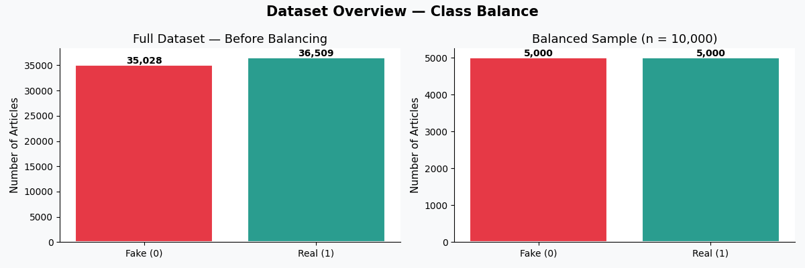
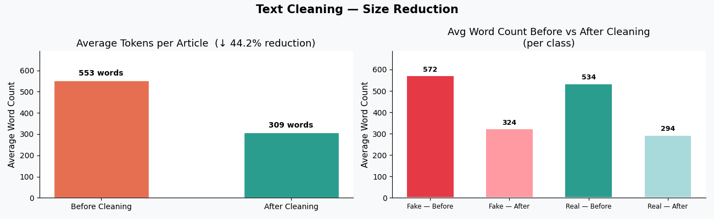
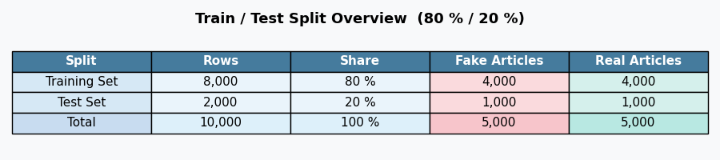
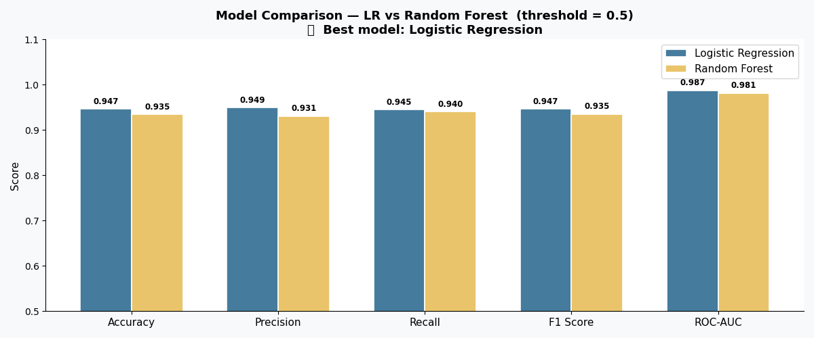
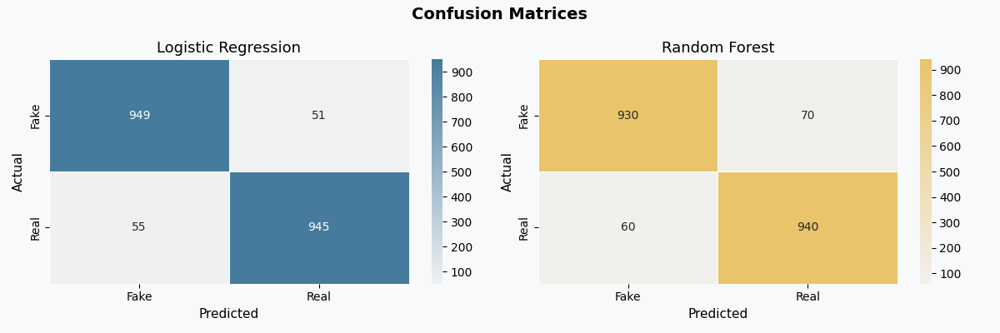
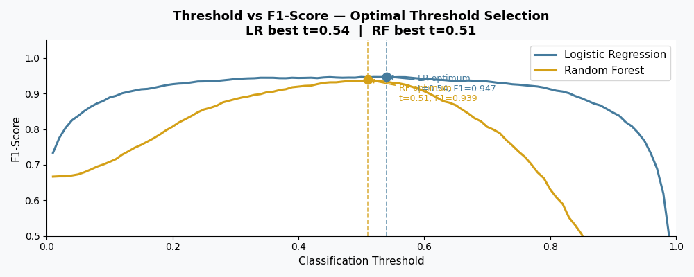
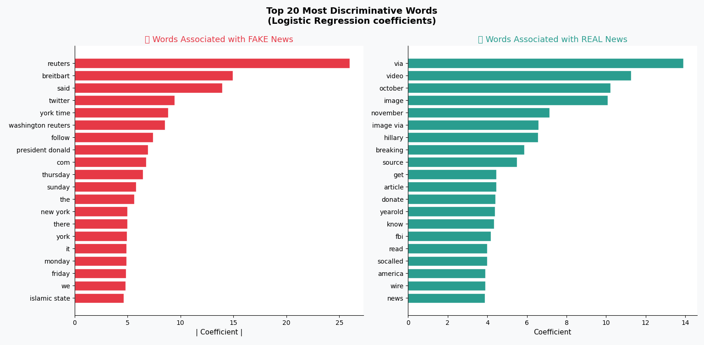
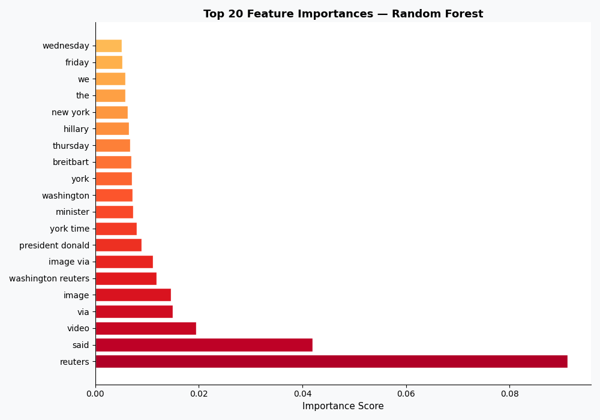

# Fake News Detection — NLP & Machine Learning

Binary text classification of news articles as **Fake (0)** or **Real (1)** using TF-IDF features with
Logistic Regression and Random Forest.

**Authors:** Malik Chourabi, Chayma Lessis — Academic Year 2025–2026
**Full report:** [`reports/Fake_news_detection_report_final_version.pdf`](reports/Fake_news_detection_report_final_version.pdf)

## Project structure

```
fake-news-detection/
├── data/
│   ├── raw/                 # Fake.csv, True.csv (Kaggle: Fake and Real News Dataset)
│   └── README.md            # data source, quirks, Git LFS note
├── figures/                 # figures used in the report (fig01 … fig08)
├── reports/                 # full project report (PDF)
├── results/                 # metrics (JSON) and plots produced by the scripts in src/
├── src/
│   ├── common.py            # data loading + text cleaning
│   ├── eda.py               # exploratory analysis
│   ├── train_baseline.py    # report pipeline: TF-IDF (1–2 grams) + Logistic Regression
│   └── train_comparison.py  # balanced 10k sample: LR vs Random Forest + threshold tuning
├── requirements.txt
├── LICENSE
└── README.md
```

## Quick start

```bash
git clone <your-repo-url> && cd fake-news-detection
python -m venv .venv && source .venv/bin/activate      # Windows: .venv\Scripts\activate
pip install -r requirements.txt

cd src
python eda.py                                  # EDA plots -> results/figures/
python train_baseline.py                       # report pipeline (full dataset)
python train_comparison.py                     # LR vs Random Forest, balanced sample
python train_comparison.py --remove-leakage    # same, without Reuters source cues
python train_baseline.py --remove-leakage --dedupe
```

## Method

1. Load `Fake.csv` / `True.csv`, assign labels, shuffle (`random_state=42`).
2. Clean text: lowercase, remove digits and punctuation, remove English stop-words.
3. Vectorise with TF-IDF (`max_features=10000`, `ngram_range=(1, 2)`).
4. 80/20 train/test split; train Logistic Regression (and Random Forest in the comparison).
5. Evaluate: accuracy, precision, recall, F1, ROC-AUC, confusion matrix, threshold sweep.

## Results

Figures from the report (`figures/`):

| | |
|---|---|
|  |  |
|  |  |
|  |  |
|  |  |

Numbers reproduced by the scripts in this repo (`results/*.json`):

| Experiment | Accuracy |
|---|---|
| Baseline LR, full data (44,898 articles, 80/20) — report reports 98.92 % | 98.78 % |
| Baseline LR, Reuters cues removed + duplicates dropped (39,105 articles) | 98.33 % |
| Balanced 10k sample, LR / RF (t = 0.5) | 98.4 % / 99.6 % |
| Balanced 10k sample, Reuters cues removed, LR / RF | 97.5 % / 97.3 % |

Small differences from the report come from the stop-word list (NLTK in the report; scikit-learn's list is
the fallback here when NLTK data is not installed) and sampling.

## Known issues — please read before publishing results

These were found while assembling this repository; they are worth fixing or at least documenting in the report.

1. **Source leakage.** Most real articles start with a `CITY (Reuters) -` dateline, so "reuters" is a near-perfect
   label proxy. Rerunning the comparison without it brings the Random Forest from 99.6 % to 97.3 % and flips which
   model is best. High scores partly reflect *which outlet wrote the article*, not whether it is true.
2. **Figures 6 and 7 (`fig06`, `fig07`) appear mislabeled.** They list *reuters*, *said*, *washington reuters* under
   "Fake" and *via*, *video*, *image* under "Real". With labels 0 = fake / 1 = real, the sign is inverted: in this
   dataset those Reuters/news-wire terms indicate **real** news, and *via/video/image* indicate **fake**
   (the scripts here confirm this). The left panel also plots absolute values. Regenerate with
   `train_comparison.py` (output: `results/figures/lr_top_words.png`).
3. **Dataset sizes disagree.** `fig01` shows 35,028 fake / 36,509 real articles (71,537), but the provided CSVs
   contain 23,481 fake / 21,417 real (44,898). The report text uses the CSV counts. Check which data produced `fig01`.
4. **Two experiments, two data setups.** The PDF reports the full-data LR baseline (~98.9 %); figures 2–8 come
   from a 10,000-article balanced experiment with LR vs Random Forest. The PDF does not describe the latter.
5. **Threshold chosen on the test set** (`fig08`), which is mildly optimistic; use a validation split for a strict result.

## Limitations

English-only static dataset, text only (no images, metadata or propagation), classical models that struggle with
sarcasm, and concept drift. Future work: Arabic/French data, multilingual BERT or AraBERT, periodic retraining.

## License

Code: MIT (see `LICENSE`). Dataset: see `data/README.md` and the Kaggle page.
